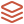
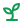

  

  

  <i>Turning ideas, workflows, and problems into useful digital experiences.</i>

  
  
  
  

  <a href="#about">About</a> &nbsp;·&nbsp;
  <a href="#tech-stack">Tech Stack</a> &nbsp;·&nbsp;
  <a href="#how-i-build">Approach</a> &nbsp;·&nbsp;
  <a href="#github-activity">Activity</a> &nbsp;·&nbsp;
  <a href="#lets-connect">Contact</a>

  

##  About

I'm a **Full Stack Developer** who enjoys building applications from both sides of the screen: from designing how users interact with a system to figuring out how everything works behind it.

I like understanding the problem behind a feature, breaking it into clear workflows, and turning it into something **practical, maintainable, and actually useful**.

<table>
  <tr>
    <td width="33%" valign="top">
      <h4> Frontend</h4>
      Responsive, accessible interfaces with React and Next.js, built around real user flows.
    </td>
    <td width="33%" valign="top">
      <h4> Backend</h4>
      Clean APIs and business logic with Laravel and NestJS, structured to scale with requirements.
    </td>
    <td width="33%" valign="top">
      <h4> Data & Delivery</h4>
      Relational data modeling with MySQL and PostgreSQL, shipped with Docker and Git-based workflows.
    </td>
  </tr>
</table>

  <b>少しずつでも、前に進む。</b> 
  <i>Even little by little, keep moving forward.</i>

##  Tech Stack

  

| Area | Technologies |
| :-- | :-- |
| **Frontend** | JavaScript, React, Next.js, HTML, CSS |
| **Backend** | PHP, Laravel, Node.js, NestJS, Python |
| **Database** | MySQL, PostgreSQL |
| **Tools & Workflow** | Git, GitHub, Docker, VS Code, Jira |

##  How I Build

| Step | Focus |
| :--: | :-- |
| **01** | **Understand the problem** before jumping into implementation |
| **02** | **Design clear workflows** that make sense for the people using them |
| **03** | **Connect the pieces** between interface, logic, and data |
| **04** | **Keep it maintainable** as requirements evolve |
| **05** | **Build with purpose**, not complexity for its own sake |

##  Currently

<table>
  <tr>
    <td> <b>Building</b> Real-world web apps with Next.js, NestJS, and Laravel</td>
    <td> <b>Exploring</b> System design and maintainable architecture</td>
  </tr>
  <tr>
    <td> <b>Experimenting</b> Data, AI, and automation</td>
    <td> <b>Learning</b> Japanese, little by little</td>
  </tr>
</table>

##  GitHub Activity

  
  

  

<!-- Snake: butuh workflow .github/workflows/snake.yml -->

  <picture>
    <source media="(prefers-color-scheme: dark)" srcset="https://raw.githubusercontent.com/nurul-fauziah/nurul-fauziah/output/github-snake-dark.svg" />
    <source media="(prefers-color-scheme: light)" srcset="https://raw.githubusercontent.com/nurul-fauziah/nurul-fauziah/output/github-snake.svg" />
    
  </picture>

##  Let's Connect

I'm always open to discussing projects, collaboration, or opportunities to learn and grow as a developer.

  

  

