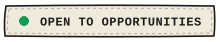
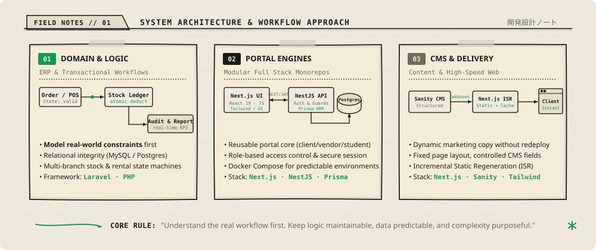
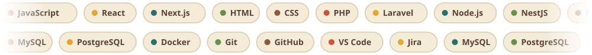
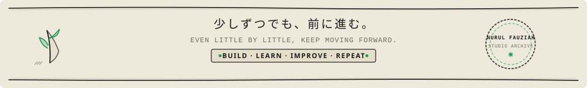

  

  <i>Informatics graduate &amp; Full Stack Developer focusing on practical business applications, backend logic, and clean web architecture.</i>

  
  &nbsp;
  
  &nbsp;
  
  &nbsp;
  

  <a href="#about">About</a> &nbsp;·&nbsp;
  <a href="#architecture">Architecture &amp; Focus</a> &nbsp;·&nbsp;
  <a href="#tech-stack">Tech Stack</a> &nbsp;·&nbsp;
  <a href="#repositories">Repositories</a> &nbsp;·&nbsp;
  <a href="#approach">Approach</a> &nbsp;·&nbsp;
  <a href="#activity">Activity</a> &nbsp;·&nbsp;
  <a href="#connect">Contact</a>

  
  

  
  

### About

I'm a **Full Stack Developer** with a background in **Informatics Engineering**. I build web applications with a focus on practical utility: turning complex operational requirements into clear workflows, reliable backend logic, and responsive user interfaces.

I care about how systems behave under the hood — data consistency, transaction integrity, and maintainable boundaries — just as much as how smoothly they operate on screen.

  
  

  
  

### What I Work On

My development focus centers on systems that solve concrete operational problems:

  

- **Business Applications &amp; ERP Systems**: Translating inventory movements, multi-branch operations, sales pipelines, and transactional ledgers into predictable relational workflows.
- **Universal Portal Foundations**: Building modular full-stack monorepos for client, vendor, and student portals with role-based access control and isolated services.
- **CMS-Driven High-Speed Websites**: Pairing Next.js with headless CMS backends (Sanity) using Incremental Static Regeneration (ISR) to give non-technical teams full content autonomy without code redeployment.

  
  

### Tech Stack

  

| Category | Technologies &amp; Tools |
| :-- | :-- |
| **Languages** | PHP, JavaScript (ES6+), TypeScript, Python, C++ |
| **Frontend** | Next.js, React, HTML5, CSS3, Tailwind CSS, Blade |
| **Backend** | Laravel, NestJS, Node.js, RESTful APIs |
| **Database &amp; ORM** | MySQL, PostgreSQL, Prisma ORM, SQLite |
| **Workflow &amp; DevOps** | Docker, Docker Compose, Git, GitHub, GitHub Actions, VS Code |

  
  

### Public Repositories

> 🌐 **Interactive Portfolio &amp; Case Studies**  
> For full case studies, UI explorations, and live interactive builds, visit my portfolio:  
> **👉 [nurulfauziah-portfolio.vercel.app ↗](https://nurulfauziah-portfolio.vercel.app/)**

| Repository | Primary Stack | Focus &amp; Description |
| :-- | :-- | :-- |
| [**ai-calendar-assistant**](https://github.com/nurul-fauziah/ai-calendar-assistant) | `TypeScript` | AI-assisted calendar scheduler and time management workflows |
| [**invoice-app**](https://github.com/nurul-fauziah/invoice-app) | `Blade` · `PHP` · `Laravel` | Business invoicing tool, item billing calculation, and PDF ledger generation |
| [**e-commerce-project**](https://github.com/nurul-fauziah/e-commerce-project) | `PHP` · `MySQL` | Web-based retail store with product catalog, cart, and checkout flow |
| [**japandi-portfolio-design**](https://github.com/nurul-fauziah/japandi-portfolio-design) | `TypeScript` · `Next.js` | Japandi aesthetic web portfolio design and editorial layout |
| [**mid-century-portfolio-design**](https://github.com/nurul-fauziah/mid-century-portfolio-design) | `TypeScript` · `React` | Mid-century modern typography and component design system |
| [**learning_journal**](https://github.com/nurul-fauziah/learning_journal) | `HTML` · `JavaScript` · `CSS` | Interactive web journal for tracking continuous engineering studies |
| [**retro_study**](https://github.com/nurul-fauziah/retro_study) | `HTML` · `JavaScript` | Focused retro-styled study timer and productivity tool |
| [**MachineLearningTask**](https://github.com/nurul-fauziah/MachineLearningTask) | `Jupyter Notebook` · `Python` | Data exploration, machine learning experiments, and statistical analysis |

  
  

### Engineering Approach

| Step | Principle | Focus |
| :--: | :-- | :-- |
| **01** | **Understand the problem** | Map business rules, edge cases, and human constraints before writing code |
| **02** | **Design clear workflows** | Break complex operational processes into predictable, transparent steps |
| **03** | **Model data for integrity** | Ensure relational consistency, clear boundaries, and atomic transactional updates |
| **04** | **Keep it maintainable** | Write readable, self-documenting code that remains clear months later |
| **05** | **Build with purpose** | Deliver real utility without premature abstraction or unnecessary complexity |

  
  

### Currently

  
  

  
  

### GitHub Activity

  

  <picture>
    <source media="(prefers-color-scheme: dark)" srcset="https://raw.githubusercontent.com/nurul-fauziah/nurul-fauziah/output/github-snake-dark.svg" />
    <source media="(prefers-color-scheme: light)" srcset="https://raw.githubusercontent.com/nurul-fauziah/nurul-fauziah/output/github-snake.svg" />
    
  </picture>

  
  

### Let's Connect

I am always open to discussing software engineering, practical web systems, collaboration, or development opportunities.

  
  &nbsp;
  

  

